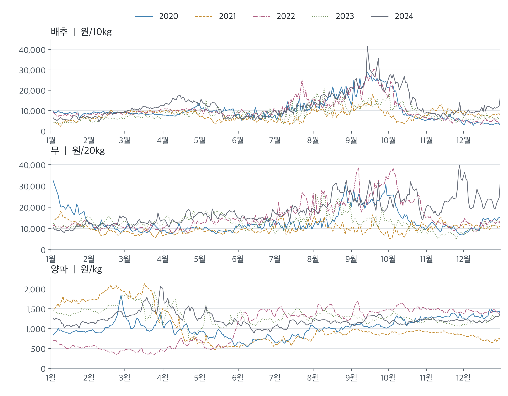
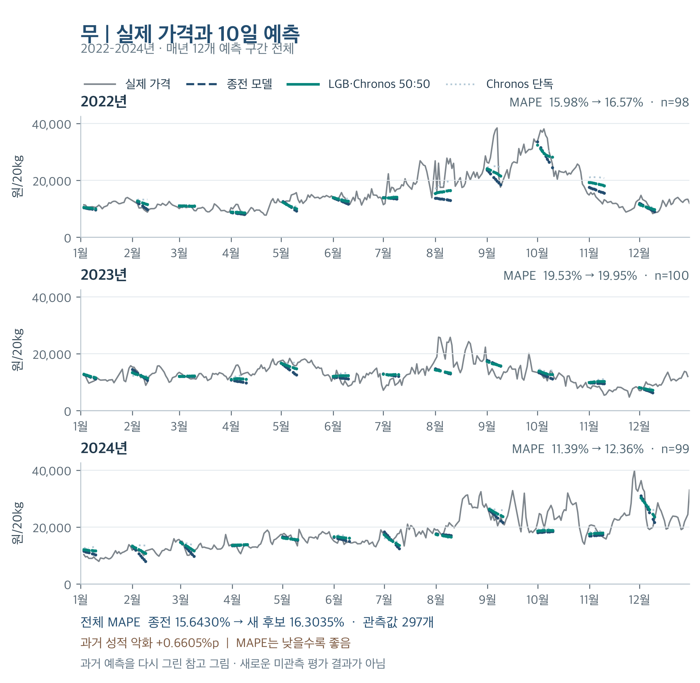

# 농산물 도매가격 예측 · 2026 AI 농산물 가격예측 해커톤

배추·무·양파·깐마늘·건고추의 도매가격을 10일 뒤, 2순 뒤, 3순 뒤까지 예측한 시계열 프로젝트입니다. 품목과 예측 기간마다 맞는 모델을 따로 고르고, 제출 패키지가 오프라인 CPU 환경에서 같은 결과를 내는지까지 확인했습니다.

| | |
|---|---|
| **대회** | 2026 AI 농산물 가격예측 온라인 해커톤 (주최 한국농수산식품유통공사) |
| **성과** | **최종 1위 · 대상(농림축산식품부 장관상)** · 394팀 중 본선 15팀 선발 · 본선 공개 리더보드 1위 (종합 MAPE 8.7174%, 2026-11-08 23:46 KST 기준) |
| **상태** | 2026년 11월 20일 최종평가(본선 리더보드 상위 5팀 발표평가)를 거쳐, 11월 21일 기준 최종 1위와 수상이 확정됐습니다. ([기록](docs/competition-record.md#final)) |
| **사용 기술** | Python · LightGBM · Chronos-2 (사전학습 시계열 모델) |
| **내 역할** | 문제를 품목·기간으로 나누고 비교 방향 설정, 실험 결과를 보고 다음 실험 결정, 선택 근거·규정·재현성 확인 요구 ([자세히](docs/project-qa.md#contribution)) |

## 문제

다섯 품목을 세 기간으로 나눠 모두 15개 조합을 예측합니다. 10일 예측은 다음 날부터 열흘간의 일별 가격이고, 2순·3순 뒤 예측은 해당 순(열흘 단위)의 평균 가격입니다. 점수는 품목별 MAPE에 가중치를 매겨 기간별로 합치고, 세 기간을 70%·15%·15%로 다시 합칩니다.

배추와 무는 해마다 여름·가을 급등 시기와 폭이 다르고, 양파는 연도마다 가격 수준 자체가 다릅니다. 품목마다 가격이 움직이는 방식이 달라서, 모델 하나로 모든 품목을 다루기 어렵다고 판단했습니다.

## 접근

### 1. 점수 구조에서 우선순위를 정했습니다

가중치를 풀어 보면 **10일 예측의 배추·무·양파 세 칸이 전체 점수의 50%** 를 차지합니다 (`0.70 × 6 / 8.4`). 그래서 이 세 칸에 실험을 집중했습니다. 깐마늘·건고추 여섯 칸은 마지막 관측 가격을 그대로 썼고, 2순·3순 뒤의 배추·무·양파 여섯 칸은 LightGBM으로 예측했습니다. 모델을 쓴 9칸의 설정을 어떻게 골랐는지는 [한계](#limits)에 적었습니다.

### 2. 품목·기간마다 모델을 따로 골랐습니다

| 품목 | 10일 | 2순 뒤 | 3순 뒤 |
|---|---|---|---|
| 배추 | Chronos-2 | LightGBM (q0.30) | LightGBM (q0.60) |
| 무 | LightGBM + Chronos-2 50:50 평균 | LightGBM (q0.45) | LightGBM (q0.40) |
| 양파 | Chronos-2 | LightGBM (q0.55) | LightGBM (L1) |
| 깐마늘 | 마지막 관측 가격 유지 | 마지막 관측 가격 유지 | 마지막 관측 가격 유지 |
| 건고추 | 마지막 관측 가격 유지 | 마지막 관측 가격 유지 | 마지막 관측 가격 유지 |

Chronos-2는 공개 체크포인트를 미세조정 없이 썼고, LightGBM은 2020\~2024년 가격으로 학습했습니다. 깐마늘과 건고추는 마지막 관측 가격을 그대로 쓰는 단순한 규칙을 유지했고, 2025년 공개 채점에서 두 품목의 MAPE는 0.3\~4.1%였습니다.

### 3. 앙상블은 오차가 서로 상쇄되는 품목에만 썼습니다

무의 2025년 10일 예측 MAPE는 LightGBM 15.84%, Chronos-2 15.50%였고, 둘을 반씩 섞으면 15.32%로 낮아졌습니다. 두 모델이 서로 다른 방향으로 틀리는 구간이 있었기 때문입니다. 반면 배추와 양파는 Chronos-2 단독이 더 나아서 섞지 않았습니다.

### 4. 제출 패키지를 대회 실행 환경과 비슷한 조건에서 다시 돌렸습니다

대회 검증 환경(4 CPU, 인터넷 차단)에 맞춰 Linux에서 네트워크를 끊고 실행했습니다. 12개 기준일 전체 추론은 68초(제한 10분), 최대 메모리는 약 2.35GiB였고, 같은 환경에서 반복 실행한 결과는 바이트 단위까지 같았습니다. 다만 Mac과 Linux 사이에서는 600개 예측값 중 98개가 최대 0.0148원 차이 났습니다. 이 차이를 숨기지 않고 원인과 함께 기록했습니다.

## 결과

본선 공개 리더보드 (2025년 문제 기준, 2026-11-08 23:46 KST 확인)

| 기간 | MAPE |
|---|---:|
| 10일 | 8.7643% |
| 2순 뒤 | 8.8317% |
| 3순 뒤 | 8.3843% |
| **종합** | **8.7174%** |

11월 8일 오후까지 리더보드에 올라 있던 이 프로젝트의 기록은 종합 9.9670%였습니다. 같은 날 2순·3순 뒤 여섯 칸의 LightGBM 설정을 2025년 점수를 보고 바꾸고 10일 배추를 세 모델 평균으로 바꿔 8.9058%가 됐습니다. 이 중간 조합은 리더보드에 올리지 않았습니다. 이어서 10일 배추·무·양파를 다시 골라 8.7174%가 됐습니다. 2순 뒤는 12.83%에서 8.83%로, 3순 뒤는 11.25%에서 8.38%로 낮아져, 9.9670%에서 줄어든 1.25%p의 대부분이 장기 설정을 바꾼 단계에서 나왔습니다.

### 최종 결과

최종평가는 2026년 11월 20일에 본선 리더보드 상위 5팀의 발표평가로 진행됐습니다. 이 프로젝트는 **최종 1위로 대상(농림축산식품부 장관상)** 수상이 확정됐습니다 (2026-11-21 기준). 발표 자료에도 아래의 한계를 함께 담았습니다.

## 한계: 이 점수를 그대로 믿기 어려운 이유

모델을 쓴 9칸(배추·무·양파 × 세 기간)의 설정은 모두 **2025년 채점 결과를 본 뒤에 골랐습니다.** 10일 세 칸의 모델 조합과 Chronos-2 설정, 2순·3순 뒤 여섯 칸의 LightGBM 분위수와 손실 함수가 여기에 들어갑니다. LightGBM 학습에는 2024년까지의 자료만 썼지만, 설정을 고를 때는 2025년 점수를 봤습니다. 2022\~2024년 비교로 뒷받침되는 선택은 무 10일 LightGBM의 경로 모양(마지막 관측 가격에서 출발하는 직선)과 깐마늘·건고추에 마지막 관측 가격을 쓴 것뿐입니다.

그래서 8.7174%는 처음 보는 데이터에서의 성능이 아닙니다. 대회는 2025년 평가 정답이나 채점 결과에 맞춰 방법·설정·혼합 비율을 고르는 것을 금지합니다. 최종 순위가 확정된 지금도, 이 점수를 일반화 성능으로 읽을 수 없다는 점은 그대로입니다.

10일 세 칸의 최종 구성을 2022\~2024년에 적용해 보면 세 품목 모두 오히려 나빠집니다.

| 10일 품목 | 2025년 (기존 → 최종) | 2022\~2024년 (기존 → 최종) |
|---|---|---|
| 배추 | 15.35% → **15.21%** | 14.37% → 15.49% |
| 무 | 15.84% → **15.32%** | 15.64% → 16.30% |
| 양파 | 5.88% → **5.40%** | 8.22% → 9.03% |

2순·3순 뒤 여섯 칸의 설정도 2022\~2024년에는 2025년만큼 맞지 않았습니다. 월말 기준일 36개(LightGBM은 해마다 그 전 자료로 다시 학습)로 다시 계산하면, 다섯 품목을 합친 기간 MAPE가 2순 뒤 14.76%, 3순 뒤 16.97%로 모든 칸에 마지막 관측 가격을 쓴 경우(11.69%, 15.86%)보다 컸습니다. 칸별로는 2순 뒤 배추가 27.6%로, 같은 기간 마지막 관측 가격(17.9%)보다 오차가 컸습니다. 15칸 전체의 종합 MAPE도 11.66%로, 마지막 관측 가격만 쓴 경우(11.46%)보다 조금 나빴습니다.

한 해의 점수만 보고 고른 구성이 다른 해에는 통하지 않을 수 있다는 것을 직접 확인한 셈입니다. 이번 프로젝트에서 가장 크게 배운 점이기도 합니다.

## 배운 점

- **모델 선택 규칙은 평가 데이터를 보기 전에 정해야 합니다.** 다음에는 후보와 선택 기준을 먼저 적어 두고, 선택에 쓰지 않는 마지막 검증 구간을 따로 남기겠습니다.
- **단순한 기준선을 함께 두어야 합니다.** 마지막 가격을 그대로 쓰는 규칙도 깐마늘·건고추에서는 오차가 작았습니다. 복잡한 모델의 효과는 이런 기준선과 비교해야 알 수 있습니다.
- **앙상블이 늘 좋아지는 것은 아닙니다.** 효과는 구성 모델의 오차가 얼마나 다른 방향인지에 달려 있었습니다.
- **"실행됐다"와 "재현됐다"는 다릅니다.** 운영체제, 배치 크기, 반올림 순서까지 기록해야 작은 수치 차이를 설명할 수 있었습니다.

## 더 읽을거리

- [프로젝트 Q&A](docs/project-qa.md): 모델을 함께 쓴 이유, 점수를 어디까지 믿을 수 있는지, AI 도구를 쓰면서 맡은 역할
- [모델 구성과 검증 회고](docs/project-retrospective.md): 기간별 모델 선택 이유, 날짜·반올림 처리, 재현성 문제
- [대회 기록과 출처](docs/competition-record.md): 대회 개요, 평가식, 참가 규모, 리더보드 확인 기록, 원문 링크

이 저장소에는 정리 문서만 있습니다. 대회 데이터, 정답, 제출 파일, 모델 가중치는 공개하지 않습니다.
